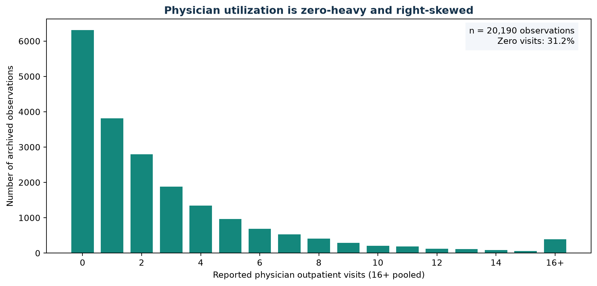
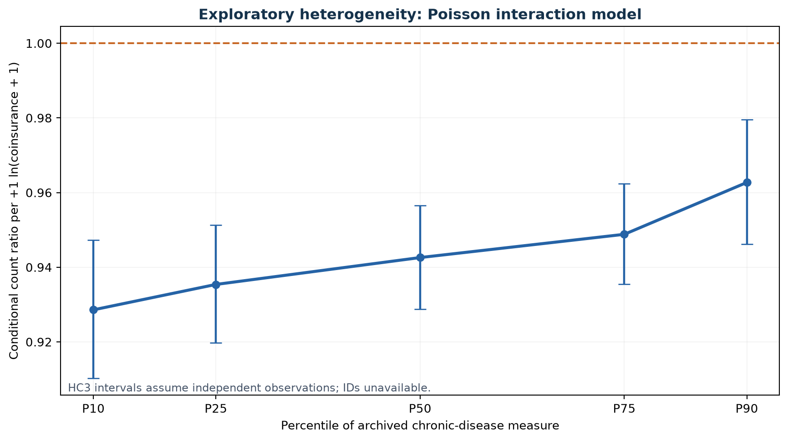
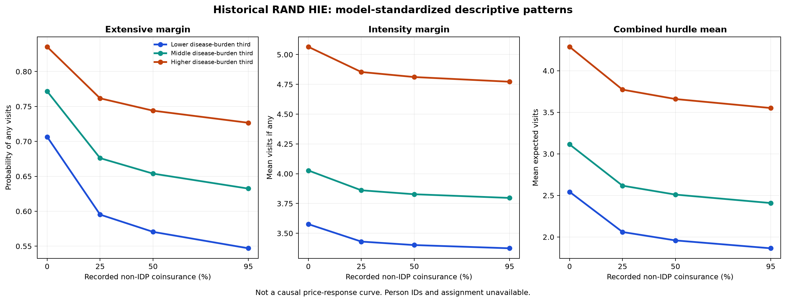
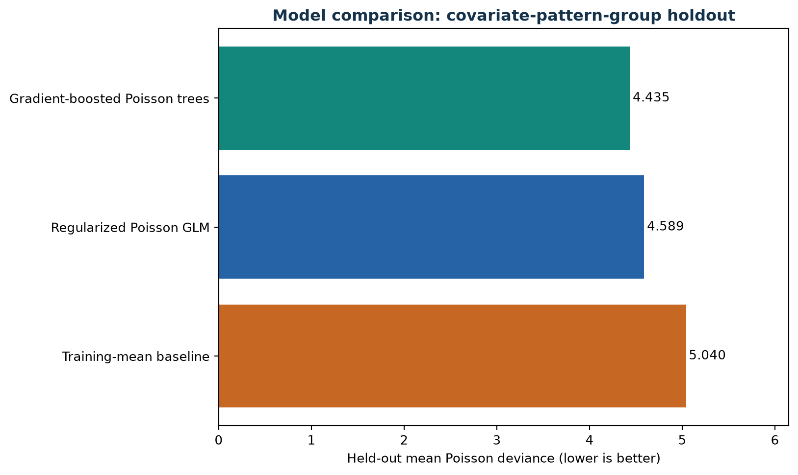

# The Price of Care
## Beyond Poisson: Insurance Cost-Sharing, Chronic Disease Burden & the Economics of Healthcare Utilization
**Healthcare Cost-Sharing | Chronic Disease Burden | Robust Count Econometrics | Two-Part Hurdle Models | Quantitative Research & Reproducible Python**

> **Core research question:** Do observed relationships between insurance cost-sharing and outpatient physician utilization vary with chronic disease burden—and how much of the apparent evidence changes with count-distribution assumptions, plan design, and nonlinear prediction?
>
> **Principal finding:** Moderation that appears statistically precise under Poisson HC3 (β = 0.0141; exploratory p = .003) is weaker under Negative Binomial NB2 (β = 0.0079; exploratory p = .094). This is a **model-robustness finding, not an identified causal insurance-price effect**.

**Research identity:** An independent Computational Health Economics project demonstrating Applied Econometrics, Quantitative Research Design, Statistical Learning, Count Likelihood Models, Predictive Model Auditing, and transparent policy interpretation.

**Explore:** [Manuscript](docs/MANUSCRIPT_APA7.md) · [Detailed Methods](docs/METHODS.md) · [Research Questions and Agenda](docs/RESEARCH_AGENDA.md) · [2026 Evidence Map](docs/LITERATURE_REVIEW_2026.md) · [Data Provenance](data/README.md) · [Verified Results](results/)

---

## Executive Research Summary

Health insurance design affects the price patients face when seeking care, but recorded healthcare utilization also reflects medical need, benefit structure, and statistical features such as excess zeros and overdispersion. This project reexamines **20,190 authentic historical observations** from the RAND Health Insurance Experiment (HIE) sample distributed through statsmodels. It compares **Poisson regression with HC3 standard errors, Negative Binomial NB2, a genuine logistic–zero-truncated NB2 hurdle likelihood, benefit-design-aware price specifications, and count-aware Machine Learning**.

Rather than reporting a single significant coefficient as a policy result, the analysis evaluates how conclusions change across defensible models, sample restrictions, and predictive benchmarks. NB2 fits the observed zero mass far better than Poisson; a two-part hurdle likelihood provides an alternative description of utilization occurrence versus positive-use intensity; categorical insurance-price terms expose a fit-versus-complexity trade-off; and gradient-boosted Poisson trees modestly improve held-out predictive loss.

**Scope of inference:** These are **historical, observational associations and predictive comparisons** within an abbreviated experimental archive. The available extract lacks participant identifiers, randomization metadata, observation dates, and several baseline covariates. It cannot reconstruct the original experiment's randomized treatment effects or establish effects of modern insurance policies.

## Scientific Contribution and Defensible Novelty

The RAND HIE and count models for healthcare utilization have extensive prior literature. **This project does not claim to discover a previously unknown causal effect, invent hurdle modeling, or be the first RAND reanalysis.**

Its defensible methodological value is the **integrated, executable audit** of conclusions using the same authentic reduced dataset:

1. **Distributional robustness:** Shows how a cost-sharing × disease-burden interaction changes between Poisson HC3, NB2, and visit-occurrence logit.
2. **Genuine two-part likelihood:** Estimates both the probability of any care and a zero-truncated NB2 distribution for the number of visits among users.
3. **Benefit-design support audit:** Separates the structurally distinct individual-deductible-plan (IDP) records before comparing continuous and categorical cost-sharing models.
4. **Prediction without causal overreach:** Compares a training-mean baseline, regularized Poisson, and boosted Poisson trees using a held-out **covariate-pattern** split, calibration, and permutation importance.
5. **Research-engineering reproducibility:** Validates source bytes, retains unidentifiable repeated records rather than arbitrarily deleting them, tests computations, and regenerates results and figures from code.

**Novelty status:** A targeted primary-literature review supports the relevance of this integrated transparency framework, but **priority relative to all published work remains unverified**; a systematic novelty audit would be required for a journal-first claim. See the [literature evidence map](docs/LITERATURE_REVIEW_2026.md). Seminal RAND reanalysis cautions against simplifying nonlinear contracts to a single elasticity ([Aron-Dine et al., 2013](https://doi.org/10.1257/jep.27.1.197)), while healthcare utilization methodology recognizes the importance of two-part count models ([Deb & Norton, 2018](https://doi.org/10.1146/annurev-publhealth-040617-013517)).

## Innovative, Testable Research Questions

| Research question | Empirical approach | Evidentiary conclusion |
|---|---|---|
| **RQ1. Is chronic-disease moderation of the recorded cost-sharing association robust to count-distribution choice?** | Poisson HC3 vs. NB2, interaction estimates, zero-mass checks, high-utilizer exclusions | **Model-sensitive:** full-sample NB2 weakens the interaction |
| **RQ2. Are differences in healthcare non-use distinct from differences in positive visit counts?** | Visit-occurrence logit + zero-truncated NB2 hurdle likelihood | **Implemented:** two-part model improves full-sample in-sample AIC; not a causal decomposition |
| **RQ3. Does treating benefit design as discrete rather than smoothly priced alter estimated associations?** | Continuous vs. categorical price terms within non-IDP support | **Mixed:** AIC favors categorical NB2; BIC favors simpler continuous NB2 |
| **RQ4. Do nonlinear models provide meaningful additional predictive information?** | Pattern-grouped holdout, Poisson deviance, MAE/RMSE, calibration, permutation importance | **Modest improvement:** boosted Poisson trees outperform regularized Poisson on one fixed holdout |
| **RQ5. Can these archived records identify which insurance policy best protects chronically ill patients?** | Identification and data-provenance audit | **No:** assignment units, IDs, dates, and key baseline data are unavailable |

These hypotheses were explored **post hoc**; the project does not claim prospective registration or confirmatory significance tests.

## Data, Provenance and Identification Constraints

| Attribute | Verified repository fact |
|---|---|
| Source | [statsmodels RAND HIE 10-variable extract](https://www.statsmodels.org/stable/datasets/generated/randhie.html), derived from authentic historical observations |
| Sample | **20,190 rows; 10 variables; 0 missing cells** |
| Outcome | Outpatient physician-visit count (mdvis) |
| Explanatory focus | Recorded log coinsurance (lncoins), continuous disease burden index (disea), plan and reported-health covariates |
| Mean / variance of visits | **2.860 / 20.289** |
| Zero-visit share | **31.243%** |
| Observed price levels | Approximately 0%, 25%, 50%, 95%, and 100% |
| Non-IDP common-support analysis | **14,941 observations**, with 0%, 25%, 50%, and 95% levels |
| Critical missing fields | Participant/family ID, random assignment, dates, age, income and full trial design |
| Data integrity | Archived-data fingerprint checks and reproducible Python tests |

The recorded disease variable contains fractional values; it is handled as a **continuous burden measure**, not silently converted to an integer diagnosis count. Identical complete rows are retained because genuine repeat observations cannot be identified without participant IDs. The historical experiment was randomized, but **this reduced research extract is insufficient for randomized causal inference**.

See [data documentation](data/README.md) and [identification analysis](docs/METHODS.md).

## Verified Quantitative Findings

### A. Overdispersion and heterogeneity require caution

| Metric | Poisson interaction | NB2 interaction |
|---|---:|---:|
| Cost-sharing × disease-burden coefficient | **0.0141** | **0.0079** |
| Nominal exploratory p-value | **.003** (HC3) | **.094** |
| Full-sample AIC | 124,798.9 | **86,788.5** |
| Pearson dispersion (using model variance) | 6.29 | **1.42** |
| Implied zero share | 8.42% | **31.97%** |
| Observed zero share | 31.24% | 31.24% |

The Poisson conditional mean may still be analytically useful, but its distributional zero prediction is poor in this sample. **A nominally significant Poisson interaction is not stable evidence of moderation** when NB2 and the visit-occurrence model are considered. HC3 also does not correct the unknown within-person or within-family dependence in the extract.

### B. Sample sensitivity: evidence is not uniform

| Sample / estimator | N | Interaction β | Exploratory p |
|---|---:|---:|---:|
| Full sample, Poisson HC3 | 20,190 | 0.0141 | .003 |
| Full sample, NB2 | 20,190 | 0.0079 | .094 |
| Excluding highest approximately 1% of utilization, NB2 | 20,007 | 0.0084 | .064 |
| Non-IDP sample, NB2 | 14,941 | 0.0164 | .002 |

The non-IDP result is stronger, but this **does not isolate an insurance treatment effect**: plan composition and sample selection also change. All p-values remain exploratory because person-level clustering and original allocation data are unavailable.

### C. A genuine two-part hurdle model improves descriptive fit

| Full-sample model | AIC | Implied zero fraction |
|---|---:|---:|
| Poisson interaction | 124,798.9 | 8.42% |
| NB2 interaction | 86,788.5 | 31.97% |
| **Logit + zero-truncated NB2 hurdle** | **86,247.0** | **31.24%** |

The hurdle likelihood separates **whether any visits occur** from **how many visits occur among positive users**. The in-sample zero share matches the data largely by construction through the occurrence equation; **it is not independent validation**.

### D. Insurance-price specification matters

| NB2 specification, 14,941 non-IDP records | AIC ↓ | BIC ↓ |
|---|---:|---:|
| Continuous logged cost-sharing | 65,508.9 | **65,592.7** |
| Categorical observed price levels | **65,501.7** | 65,615.8 |

More flexible price modeling marginally improves AIC but incurs a BIC complexity penalty. The 100% category is excluded from this within-plan comparison because it occurs under the distinct IDP structure in the archive.

### E. Nonlinear Machine Learning adds modest predictive value

| Held-out benchmark | Mean Poisson deviance ↓ | MAE ↓ | RMSE ↓ |
|---|---:|---:|---:|
| Training-mean baseline | 5.040 | 2.858 | 4.837 |
| Regularized Poisson GLM | 4.589 | 2.692 | 4.686 |
| **Gradient-boosted Poisson trees** | **4.435** | **2.622** | **4.638** |

The boosted model reduces held-out Poisson deviance by approximately **3.3% relative to regularized Poisson** and approximately **12.0% relative to the training-mean baseline** on one fixed split.

This is a split by identical **covariate patterns**, not verified distinct patients. The dataset does not support person-level out-of-sample generalization. Permutation importance describes **predictive reliance**, not causal importance.

Exact machine-generated outputs: [model diagnostics](results/econometric_model_diagnostics.json) · [interaction sensitivity](results/interaction_sensitivity_checks.csv) · [hurdle diagnostics](results/hurdle_model_diagnostics.json) · [price specification](results/price_functional_form_comparisons.csv) · [ML benchmarks](results/ml_holdout_metrics.csv) · [split audit](results/predictive_split_audit.json).

## Eight Reproducible Research Visualizations

All plots were generated from the authentic historical dataset and are saved as both PNG and SVG. Model curves are **fitted associations**, not policy treatment responses.

| Figure | What it documents |
|---|---|
| [1. Physician-visit distribution](figures/figure_1_visits_distribution.png) | Excess zeros, high dispersion and long-tail utilization |
| [2. Observed cost-sharing and disease heterogeneity](figures/figure_2_costshare_disease_heterogeneity.png) | Descriptive group means under observed plan prices |
| [3. Poisson interaction margins](figures/figure_3_interaction_margins.png) | Conditional ratios with nominal HC3 intervals |
| [4. Held-out predictive comparison](figures/figure_4_ml_comparison.png) | Count-aware ML benchmark |
| [5. Permutation feature importance](figures/figure_5_permutation_importance.png) | Predictive reliance, not causal attribution |
| [6. Prediction calibration](figures/figure_6_prediction_calibration.png) | Actual versus predicted utilization by quintile |
| [7. Hurdle occurrence and intensity](figures/figure_7_hurdle_decomposition.png) | Probability of any use and positive-count intensity |
| [8. Price functional form](figures/figure_8_price_functional_form.png) | Continuous versus categorical NB2 under non-IDP support |

## Policy Interpretation: What the Evidence Warrants

**Evidence-led policy conclusion:** This reduced historical archive **does not identify an optimal cost-sharing schedule, an effect of removing copayments, or a causal benefit for chronically ill patients**. It does demonstrate why analyses informing insurance design should be robust to count distribution, non-use, plan heterogeneity, and predictive-model assumptions.

| Verified analytical finding | Responsible policy-research implication | Evidence required before a policy recommendation |
|---|---|---|
| Poisson and NB2 disagree on moderation strength | Do not base disease-specific benefit design on a single significant interaction | Identified treatment comparisons with appropriate participant/family clustering |
| Approximately 31% report no visits | Distinguish **access / any use** from **frequency among users** in evaluation plans | Longitudinal measures of medical need, barriers and health outcomes |
| Price categories are linked to plan structure | Audit insurance benefit design and overlap before estimating price contrasts | Comparable plans or a credible randomized/quasi-experimental source of variation |
| Boosting improves prediction modestly | Treat ML as a complementary forecasting and diagnostic tool | Independent validation, fairness checks and causal evaluation before policy use |
| Current extract lacks IDs and assignment | State the boundary between descriptive modeling and randomized evidence explicitly | Complete trial design or a new well-identified policy study |

**Substantive implication for Health Economics:** Future benefit-design studies should evaluate heterogeneity by **baseline** chronic disease need, separately model the extensive and intensive utilization margins, and examine whether reductions in visits reflect reduced low-value use or harmful forgone care. **These are research priorities, not findings established by this extract.**

## Three Next-Stage Research Directions (Proposed; Not Yet Implemented)

| Rank | Research extension | Contribution / testable question | Feasibility / cost | Novelty and impact status |
|---|---|---|---|---|
| **1 — Practical** | **Transportable healthcare-use prediction** using public MEPS-compatible data | Do distribution-aware count models and calibrated ML retain their advantage across years and demographic groups? | Moderate feasibility; low-to-moderate cost; data harmonization required | Benchmark extension; novelty requires audit |
| **2 — Policy-oriented** | **Chronic-need equity and cost-sharing gradients** | Are utilization gradients more sensitive to insurance-price design for groups with greater *baseline* need, and is reported non-use linked to adverse access measures? | Moderate feasibility; moderate cost; observational associations unless identified variation exists | Potential substantive value; causal mechanism unverified |
| **3 — Ambitious causal study** | **RAND experimental heterogeneity re-estimation** | Do randomized insurance assignments have different intention-to-treat effects by baseline chronic disease burden on any use, visit counts and health outcomes? | Lower immediate feasibility; access to complete identifiers, allocation and baseline measures required | Highest potential causal contribution, subject to prior-work and data audit |

**Recommended first experiment:** Extend the computational benchmark to an appropriately documented, publicly accessible healthcare-use sample, prespecify outcome definitions and splits, compare Poisson, NB2, hurdle, and boosted count models, and report calibration and subgroup error. Until independent data are analyzed, **no results are claimed** for these extensions.

**Causal design requirements:** For an original RAND reanalysis, recover treatment allocation, randomization unit, baseline morbidity, participant/family IDs, dates and attrition before estimating clustered intention-to-treat effects. For observational policy changes, specify the identification strategy and interrogate confounding, policy selection, anticipation, pretrends and spillovers. Neither Explainable AI nor HC3 standard errors substitutes for identification.

## Quantitative and Computational Research Skills Demonstrated

- **Applied Econometrics and Quantitative Inference:** Poisson HC3, Negative Binomial NB2, logistic occurrence, zero-truncated NB2 likelihood, interactions, delta-method margins, sensitivity analysis, AIC/BIC, distributional diagnostics.
- **Computational Health Economics:** insurance-plan support checks, chronic-disease burden stratification, utilization occurrence/intensity decomposition, transparent interpretation of claims-like utilization counts.
- **Machine Learning and Predictive Analytics:** regularized count GLMs, boosted Poisson trees, pattern-group holdouts, model calibration, deviance/MAE/RMSE, permutation feature reliance, leakage-limit documentation.
- **Reproducible Research Engineering:** Python, deterministic runs, data hashing, source-provenance checks, documented scripts, test automation and CI.
- **Research and Policy Communication:** research-question formulation, methodological triangulation, evidence-quality appraisal, transparent separation of descriptive findings from causal policy claims.

**Professional positioning:** Demonstrates transferable capabilities for **Computational Economist, Quantitative Researcher, Health Economics Analyst, Applied Econometrician, AI/ML Research Scientist, and Policy Evaluation Researcher** roles. It is an independent computational research portfolio, **not** a claim of verified clinical experience, restricted claims-data access, or peer-reviewed publication of these particular results.

## Reproduce the Analysis

**Requirements:** Python 3.10+; the versioned authentic sample is bundled locally. No network download, API credentials, or patient-identifiable information is required.

    python -m venv .venv
    # Windows PowerShell: .\.venv\Scripts\Activate.ps1
    # macOS/Linux: source .venv/bin/activate
    python -m pip install -e ".[dev]"
    pytest -q
    python -m health_econ.cli

The CLI checks the dataset fingerprint and regenerates Econometric outputs, Machine Learning metrics and all eight figures. Small platform differences in tree fitting can occur; inspect the exact committed [ML score file](results/ml_holdout_metrics.csv) for verified comparison values.

## Repository Guide

| Folder / file | Purpose |
|---|---|
| [data/](data/) | Historical extract, provenance and SHA-256 validation |
| [src/health_econ/](src/health_econ/) | Data checks, Econometrics, hurdle model, ML and plotting |
| [results/](results/) | Actual diagnostics, coefficients, sensitivity checks and scores |
| [figures/](figures/) | Eight reproducible figures in PNG and SVG |
| [tests/](tests/) | Data, scientific computation and reproducibility checks |
| [docs/MANUSCRIPT_APA7.md](docs/MANUSCRIPT_APA7.md) | Detailed manuscript and literature context |
| [docs/METHODS.md](docs/METHODS.md) | Models, equations, identification, split and inference limitations |
| [docs/RESEARCH_AGENDA.md](docs/RESEARCH_AGENDA.md) | Implemented and future hypotheses |
| [docs/LITERATURE_REVIEW_2026.md](docs/LITERATURE_REVIEW_2026.md) | Targeted evidence map and novelty audit |
| [.github/workflows/reproduce.yml](.github/workflows/reproduce.yml) | Automated research reproduction |

## Research Integrity, Limitations and Attribution

**Limitations:** Missing person/family IDs prevent verification of independent rows and correct trial-unit clustering. The archived data lack randomization metadata, dates and several patient covariates. Original disease variables contain fractional measures; insurance-plan variables may be mechanically interrelated. Multiple exploratory comparisons were not preregistered. A fixed covariate-pattern holdout is not a patient-level holdout. Historical observations cannot establish modern clinical or coverage impacts.

**Licensing and provenance:** Original code and documentation are MIT-licensed. The historical sample is attributed to the RAND Health Insurance Experiment via statsmodels; these independent analyses and interpretations **must not be attributed to RAND Corporation or the original trial investigators**. Refer to [data provenance](data/README.md) for source documentation.

## Selected References

Aron-Dine, A., Einav, L., & Finkelstein, A. (2013). The RAND health insurance experiment, three decades later. *Journal of Economic Perspectives, 27*(1), 197–222. https://doi.org/10.1257/jep.27.1.197

Brot-Goldberg, Z. C., Chandra, A., Handel, B. R., & Kolstad, J. T. (2017). What does a deductible do? The impact of cost-sharing on health care prices, quantities, and spending dynamics. *The Quarterly Journal of Economics, 132*(3), 1261–1318. https://doi.org/10.1093/qje/qjx013

Cameron, A. C., & Trivedi, P. K. (2013). *Regression analysis of count data* (2nd ed.). Cambridge University Press. https://doi.org/10.1017/CBO9781139013567

Deb, P., & Norton, E. C. (2018). Modeling health care expenditures and use. *Annual Review of Public Health, 39*, 489–505. https://doi.org/10.1146/annurev-publhealth-040617-013517

Manning, W. G., Newhouse, J. P., Duan, N., Keeler, E. B., Leibowitz, A., & Marquis, M. S. (1987). Health insurance and the demand for medical care: Evidence from a randomized experiment. *The American Economic Review, 77*(3), 251–277. https://pubmed.ncbi.nlm.nih.gov/10284091/

**Further evidence:** [2026 literature map and research design comparisons](docs/LITERATURE_REVIEW_2026.md).
