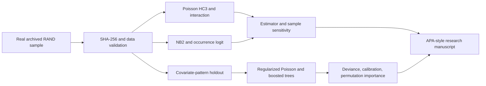

# THE PRICE OF CARE
### Cost-Sharing, Chronic Disease Burden, Count Econometrics & Interpretable ML

**Real-data Health Economics Research** · Applied Econometrics · Count Models · Explainable Machine Learning · Reproducible Python

   

> **Research Question:** Does the recorded cost-sharing–physician utilization relationship vary with chronic disease burden—and do these findings hold up under Negative Binomial Econometrics and nonlinear Machine Learning?

[](https://github.com/muhammad-siddique-research/price-of-care-health-economics/actions/workflows/reproduce.yml)

**Research Library:** [2026 Evidence Map](docs/LITERATURE_REVIEW_2026.md) · [Detailed Two-Part Methods](docs/METHODS.md) · [APA Manuscript](docs/MANUSCRIPT_APA7.md).  
**Original Materials:** [APA 7th-style Manuscript](docs/MANUSCRIPT_APA7.md) · [Data Provenance](data/README.md) · [Research Methodology](docs/METHODS.md) · [Research Agenda](docs/RESEARCH_AGENDA.md).

## Novelty of this Project

The RAND Health Insurance Experiment is a landmark study in Health Economics. This independent project analyzes **real archived research observations**, unlike a synthetic Medicare methods demonstration. The provided file is a **reduced 10-variable historical sample**, not the entire experiment; critically it has **no participant IDs, experimental assignment, or time stamps**. We therefore do not claim randomized treatment effects, independent-patient validation, or current clinical recommendations.

The intellectual contribution here is **reproducible model-robustness triangulation, a true zero-truncated NB2 hurdle likelihood, and insurance-plan support auditing**: a seemingly precise cost-sharing × health-burden interaction in a Poisson model becomes weaker under a Negative Binomial model that better captures dispersion. The entire analysis is reproducible and the limits of inference are explicit.

## Verified Empirical Findings (20,190 Real Observations)

| Research Question / Statistic | Calculated Result |
|---|---:|
| Mean physician visits per archived observation | **2.86** |
| Observations with zero visits | **31.2%** |
| Visit count variance | **20.29** |
| Poisson-interaction implied zero fraction | 8.4% |
| NB2-interaction implied zero fraction | **32.0%** |
| Cost-sharing × chronic burden, Poisson HC3 | beta = 0.0141; exploratory *p* = .003 |
| Cost-sharing × chronic burden, NB2 | beta = 0.0079; exploratory *p* = .094 |
| Test Poisson deviance, regularized Poisson | 4.589 |
| Test Poisson deviance, Gradient-Boosted Poisson Trees | **approximately 4.44** |
| Full-sample logit + zero-truncated NB2 hurdle AIC | **86,247** |
| Non-IDP NB2 AIC, categorical vs continuous cost-sharing | **65,502 vs 65,509** |

**Interpretation:** Poisson may overstate certainty when severe overdispersion and zero counts are inadequately modeled; however, NB2 and HC3 nominal tests also **cannot** correct unknown within-person clustering. The exploratory H2 moderation is **not robustly established**. The ML uplift is modest and predictive—not causal.

## Eight Real-data, Reproducible Research Figures

### Figure 1 — Why Visit Counts Require Appropriate Econometrics


### Figure 2 — Cost-sharing Patterns by Chronic Disease Burden


### Figure 3 — Model-based disease heterogeneity with HC3 intervals


### Figure 4 — Out-of-pattern predictive accuracy


### Figure 5 — Explainable ML: Predictive Reliance, not Causality


### Figure 6 — Calibration Across Prediction Quintiles


### Figure 7 — Extensive versus Intensive Healthcare Utilization


The true **logistic + zero-truncated NB2** model separates starting care from the number of visits once care is used. Each curve is a **descriptive, model-standardized association**, not a policy-treatment curve.

### Figure 8 — Continuous VS Categorical Insurance-Price Modeling


In the observed **non-IDP subgroup**, 0%, 25%, 50%, and 95% coinsurance coexist. The 100% price category is structurally tied to the separate IDP plan. Categorical NB2 improves AIC modestly, but **BIC favors the simpler continuous model**. Both specifications are reported, not cherry-picked.

All eight charts were generated from **Real Archived Observations**; each is available as a PNG and editable, resolution-independent SVG. The dataset is historical, excludes patient identifiers, and cannot establish present-day medical or insurance effects.

## Analytical Research Workflow



## Scientific Competencies Demonstrated

**Applied Econometrics:** Poisson GLM, HC3 sandwich standard errors, NB2 dispersion estimation, **zero-truncated NB2 hurdle likelihood, occurrence/intensity decomposition, observed-plan-support comparisons, categorical and continuous price form sensitivity**, interaction coefficients, count ratios, likelihood/AIC model comparisons, binomial logit, zero-mass adequacy, and sensitivity to sample composition.

**Machine Learning:** Baseline versus regularized Poisson and gradient-boosted trees, a stringent exact-covariate-pattern holdout, Poisson deviance, MAE/RMSE, test-set permutation feature reliance, and prediction calibration.

**Research Engineering:** Authentic data with a SHA-256 manifest, source attribution, programmatic validation, non-invention of fractional disease-score values, deterministic seeds, reproducible outputs, automated tests, and CI for Python 3.10 and 3.12.

**Research Ethics:** Complete publication-style methodology, reproducibility statement, inconclusive and sensitivity-dependent findings, historical-study limitations, and literature references in APA 7th style.

## One-command Reproducibility

Python 3.10+ required:

```bash
python -m venv .venv
# On Windows PowerShell: .\.venv\Scripts\Activate.ps1
# On macOS/Linux: source .venv/bin/activate
python -m pip install -e ".[dev]"
pytest -q
python -m health_econ.cli
```

The bundled CSV, `data/rand_hie_statsmodels_sample.csv`, was copied from the **public-domain historical dataset** provided in `statsmodels.datasets.randhie`; it is **not generated or simulated**. The command verifies its stored checksum, computes Econometric and ML results, and regenerates the eight figures. Small platform-specific floating-point differences in tree learning may occur; `results/ml_holdout_metrics.csv` is the source of exact values for each verified run. No secret keys, API access, network downloads, or restricted patient information are required.

## Repository Architecture

```text
data/                         Real historical RAND subset and source SHA-256
src/health_econ/data.py         Input provenance, validation, constructed indicators
src/health_econ/econometrics.py  Poisson, NB2, logistic, interactions
src/health_econ/robustness.py    Distributional and sample checks
src/health_econ/hurdle.py        Logistic + zero-truncated NB2 and margins
src/health_econ/functional_form.py  Plan-support-restricted NB2 comparisons
src/health_econ/ml.py            Pattern-group split and interpretable ML
src/health_econ/plots.py         Publication-quality PNG and SVG figures
src/health_econ/cli.py           Reproducible research runner
docs/MANUSCRIPT_APA7.md         Article with empirical results and APA references
docs/METHODS.md                 Equations, modeling and identification limits
docs/RESEARCH_AGENDA.md         Hypotheses, value addition, further research
docs/LITERATURE_REVIEW_2026.md  Recent primary literature and evidence-gap audit
results/                        Actual model outputs, sensitivity, audit, ML scores
figures/                        Eight empirical figures in PNG and SVG
tests/                          Dataset provenance and reproducibility checks
.github/workflows/ci.yml        Full rerun on pushes and pull requests
```

## Limitations of the Study

1. **Historical, real but incomplete sample.** No participant ID, experimental assignment, observation date, age, or income is available, so this is **not an identified randomized causal study**.
2. **Participant clustering unknown.** HC3 standard errors assume independent rows and may be optimistic. The covariate-fingerprint split is not a verified person-level holdout.
3. **Variable documentation imperfect.** Chronic disease and physical limitation fields contain fractional values; we preserve original observations rather than fabricating clinical events.
4. **Nominal significance is exploratory.** Interactions differ by model, plan structure and selection of high utilizers.
5. **No new-literature-priority claim.** This is a reproducible robustness and research training contribution; novelty requires a systematic literature review and additional identifiers.

## Research Conclusion

The result worth highlighting is methodological rather than sensational: *overdispersion changes how strongly we should believe observed cost-sharing interactions*. NB2 fits the real count distribution substantially better than Poisson, and the **hurdle likelihood separates visit non-use and positive-use intensity**. Alternative price functional forms reveal meaningful fit/complexity tradeoffs. Nonlinear Poisson boosting improves predictive loss without resolving causal identification. This distinction is central to credible Health Economics and Applied Econometrics research.

## Selected References

Aron-Dine, A., Einav, L., & Finkelstein, A. (2013). The RAND health insurance experiment, three decades later. *Journal of Economic Perspectives, 27*(1), 197–222. https://doi.org/10.1257/jep.27.1.197


Brot-Goldberg, Z. C., Chandra, A., Handel, B. R., & Kolstad, J. T. (2017). What does a deductible do? The impact of cost-sharing on health care prices, quantities, and spending dynamics. *The Quarterly Journal of Economics, 132*(3), 1261–1318. https://doi.org/10.1093/qje/qjx013

Cameron, A. C., & Trivedi, P. K. (2005). *Microeconometrics: Methods and applications*. Cambridge University Press. https://cameron.econ.ucdavis.edu/mmabook/mma.html

Cameron, A. C., & Trivedi, P. K. (2013). *Regression analysis of count data* (2nd ed.). Cambridge University Press. https://doi.org/10.1017/CBO9781139013567

Deb, P., & Norton, E. C. (2018). Modeling health care expenditures and use. *Annual Review of Public Health, 39*, 489–505. https://doi.org/10.1146/annurev-publhealth-040617-013517

Gidwani, R., Yank, V., Burgette, L., Kofner, A., Asch, S. M., & Wagner, Z. (2024). The impact of telehealth cost-sharing on healthcare utilization: Evidence from high-deductible health plans. *Health Services Research, 59*(6), e14343. https://doi.org/10.1111/1475-6773.14343

Manning, W. G., Newhouse, J. P., Duan, N., Keeler, E. B., Leibowitz, A., & Marquis, M. S. (1987). Health insurance and the demand for medical care: Evidence from a randomized experiment. *The American Economic Review, 77*(3), 251–277. https://pubmed.ncbi.nlm.nih.gov/10284091/

Newhouse, J. P., & the Insurance Experiment Group. (1993). *Free for all? Lessons from the RAND Health Insurance Experiment*. Harvard University Press. https://books.google.com/books?id=SVUJ4W9Lk5IC

Statsmodels Developers. (2022). *RAND Health Insurance Experiment Data*. Statsmodels. https://www.statsmodels.org/stable/datasets/generated/randhie.html

Tran, A., Laporte, A., Nauenberg, E., & Hoagland, A. (2026). Role of chronic conditions in out-of-pocket costs for preventive care in the US. *JAMA Network Open, 9*(1), e2553157. https://doi.org/10.1001/jamanetworkopen.2025.53157

See [the evidence map](docs/LITERATURE_REVIEW_2026.md) for the 2026 *Health Economics* article by Chen et al. and a study-design comparison.

## License

Code and original research documentation: MIT. The archived RAND subset is distributed as public-domain data in statsmodels, with full provenance and source credits. These independent project results should not be attributed to RAND Corporation or the original experimental research team.
