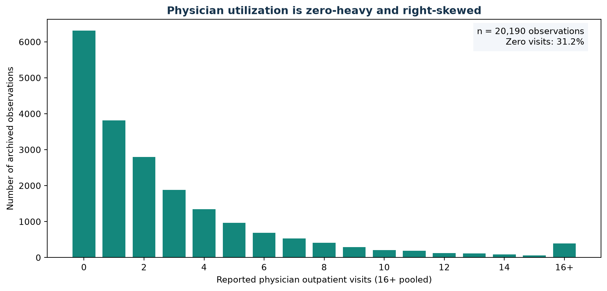
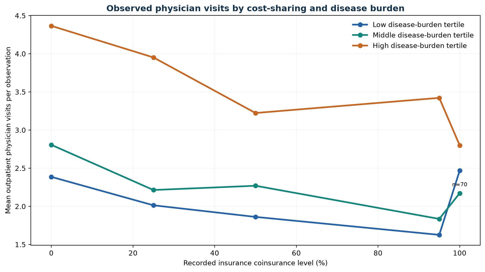
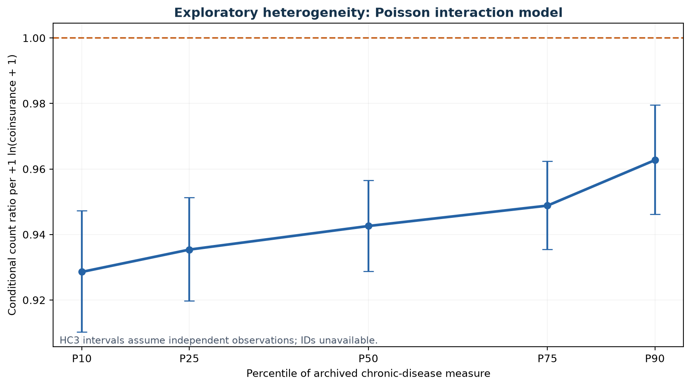
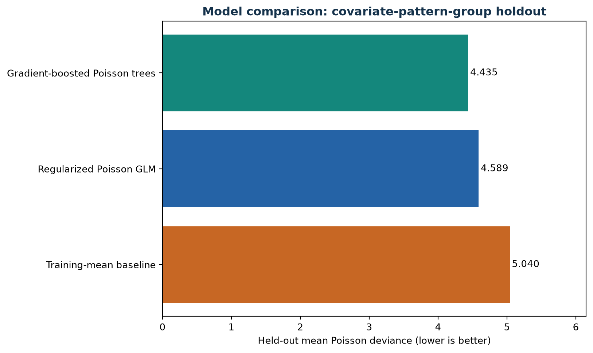
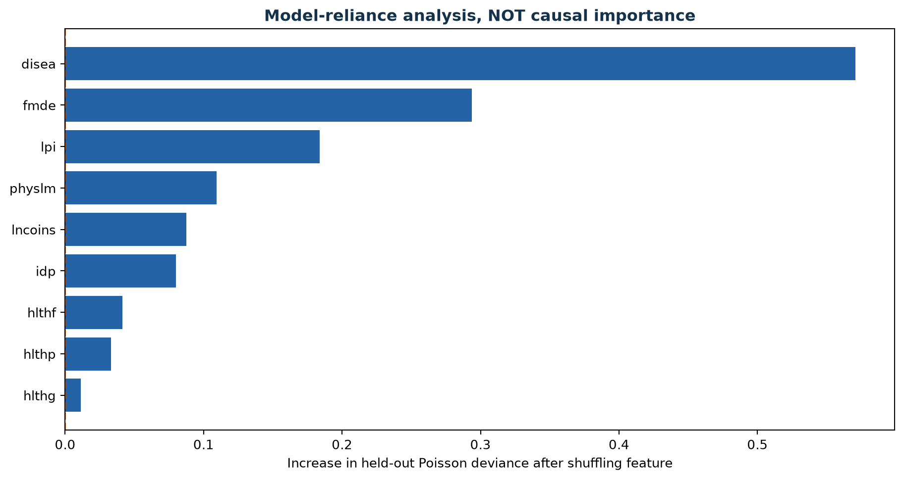
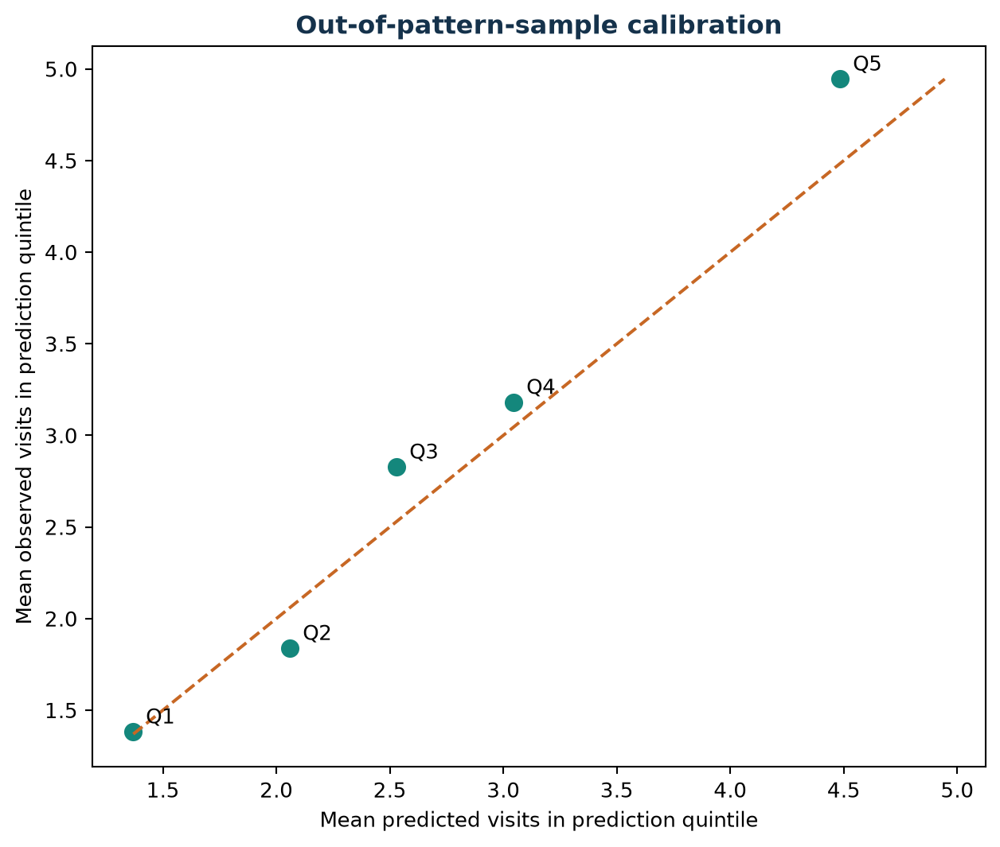
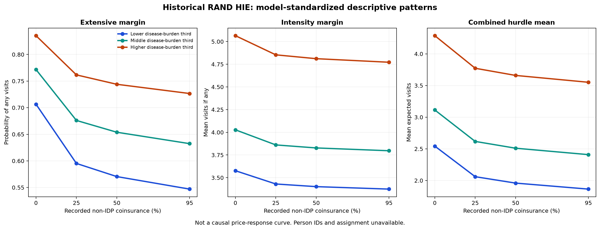
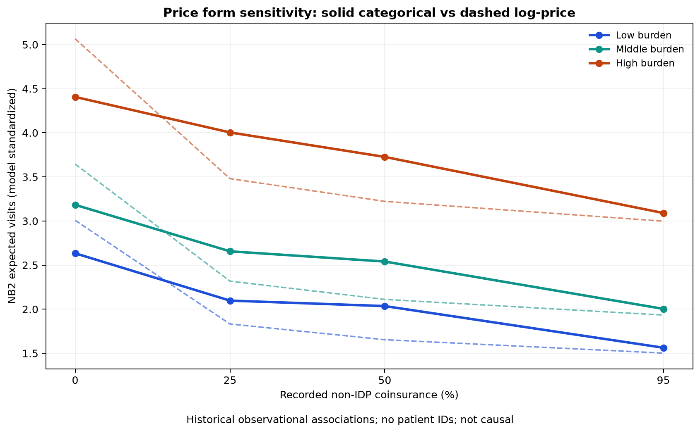

# The Price of Care: Chronic Disease Burden and Cost-Sharing in Physician Utilization

### A Reproducible Econometric, Two-Part Hurdle, and Predictive Machine Learning Study of Historical RAND Health Insurance Experiment Observations

**Research type:** Reproducible computational reanalysis of historical, real observations.  
**Dataset:** 20,190 observations and 10 variables, RAND Health Insurance Experiment research extract, publicly distributed via `statsmodels` (v0.14.6).  
**Study scope:** Exploratory and associational; **not** a re-estimation of the original randomized experimental treatment effect.  
**Reporting format:** APA 7th-style in-text citations and references, with computational equations and reproducible code (GitHub Markdown is not a fully typeset journal submission).  
**Revision:** October 2026; updated literature through 2026 and expanded models.

## Abstract

**Background.** Cost-sharing can influence health service utilization, especially when medical needs differ. Conclusions about heterogeneity can also depend on distributions with many zero and highly dispersed visit counts. **Objective.** Assess how a recorded coinsurance–chronic-disease interaction behaves under robust count Econometrics, a genuine two-part hurdle likelihood, alternative insurance-price functional forms, and predictive Machine Learning. **Data and methods.** We analyzed 20,190 genuine historical RAND Health Insurance Experiment observations from the publicly distributed 10-variable statsmodels extract. We estimated Poisson HC3, NB2, logistic occurrence, logistic plus zero-truncated NB2 hurdle models, and categorical versus continuous price specifications within observed non-individual-deductible-plan (non-IDP) support. Predictive ML comparisons used a covariate-pattern holdout. **Results.** Mean visits were 2.86 and 31.24% of observations reported zero. The chronic-burden interaction was 0.0141 in Poisson (exploratory *p* = .003) and 0.0079 in NB2 (*p* = .094). The full-sample hurdle model yielded AIC = 86,247 compared with NB2 AIC = 86,789 and Poisson AIC = 124,799. Within the 14,941 non-IDP observations, categorical NB2 price specifications improved AIC (65,502 vs. 65,509), but BIC favored the simpler continuous specification. Gradient-boosted Poisson prediction improved held-out deviance modestly. **Conclusions.** Cost-sharing moderation is model-sensitive. Distribution-aware count methods, separating visit initiation from intensity, and checking benefit-design overlap improve research transparency. Because participant identifiers and randomization metadata are absent, results are **noncausal, exploratory associations**.

**Keywords:** Health Economics; Insurance Cost-Sharing; Chronic Disease Burden; Hurdle Count Models; Zero-Truncated Negative Binomial; Model Robustness; Machine Learning; Reproducible Research.

## 1. Introduction and literature context

Healthcare insurance reduces direct payment at the point of service, potentially influencing demand through changes in the marginal out-of-pocket price. Demand also reflects health need, liquidity constraints, provider access and institutional rules. The original RAND Health Insurance Experiment used random insurance assignments and documented reductions in utilization under cost sharing (Manning et al., 1987; Newhouse & the Insurance Experiment Group, 1993). Later work demonstrated that a move to high deductibles can reduce service quantities without relying primarily on price shopping (Brot-Goldberg et al., 2017).

Recent studies underline the contemporary relevance of chronic conditions and financial barriers, while employing different research designs and data: Gidwani et al. (2024) examined a telehealth cost-sharing policy shift among chronically ill insured people; Chen et al. (2026) investigated chronic-disease outpatient insurance coverage in China; Tran et al. (2026) studied unexpected preventive-care out-of-pocket costs among people with chronic conditions. These studies are **context**, not validations of an estimated RAND treatment effect. For the appropriate count-data methods, Deb and Norton (2018) emphasize zero-heavy healthcare-use outcomes and hurdle models. Aron-Dine et al. (2013) caution against interpreting the RAND experiment through a single structural price elasticity. See the [2026 evidence map](LITERATURE_REVIEW_2026.md) for scope and contrasts.

However, average utilization associations can obscure variation in health needs. Chronic disease burden plausibly changes clinical necessity, patient responsiveness and the distribution of visits. This raises an applied methodological question: **Does the apparent moderation of cost-sharing by chronic disease burden survive models that adequately accommodate overdispersed healthcare-use counts?**

**Proposed contribution:** This code-driven study triangulates three facets that are too often conflated: coefficient heterogeneity under alternative Econometric distributions, utilization occurrence versus total count outcomes, and predictive information in a flexible Poisson-loss model. The value added is a transparent, executable demonstration of **how a conclusion changes across models and sample restrictions**. No comprehensive systematic review has yet established that this constitutes an unprecedented gap in published literature.

### Exploratory hypotheses

**H1:** Higher recorded cost-sharing is negatively associated with visit counts, conditional on included covariates.  
**H2:** Chronic disease burden moderates the apparent cost-sharing association, but the strength of moderation is model-dependent.  
**H3:** A complete two-part hurdle likelihood provides an alternative account of zero and positive visits.  
**H4:** Non-IDP categorical price contrasts expose functional-form sensitivity relative to a continuous log-price term.  
**H5:** Nonlinear Machine Learning achieves lower held-out Poisson deviance than both the sample-mean baseline and regularized Poisson regression.

The hypotheses are **exploratory post hoc specifications**, not prospectively registered randomized-trial tests.

## 2. Data and data quality

The data are an authentic, archived subset of the historical RAND experiment, distributed as `statsmodels.datasets.randhie` and derived from a sample used by Cameron and Trivedi (2005). The file contains **20,190 real observations** with no missing values across the 10 distributed variables. A SHA-256 manifest in `data/PROVENANCE.json` verifies exact local data bytes. The original experiment was randomized; however, this subset omits **participant identifiers, treatment-assignment records, visit dates, study year, age, income and geography**. Randomized treatment effects **cannot** be reconstructed from this extract.

There are **11,065 identical complete rows** across its 10 variables. These are retained: a repeated value combination is not proof of a duplicate individual or a data error, and the dataset lacks identifiers required for deduplication or within-subject covariance estimation. The chronic disease variable `disea` is sometimes fractional, despite its abbreviated source label referring to disease counts. It is therefore analyzed as a continuous **recorded chronic-disease burden measure**, not a fabricated integer diagnosis count. The `physlm` measure also contains fractional values and is not forcibly binarized.

| Original field | Definition used |
|---|---|
| `mdvis` | Nonnegative number of outpatient physician visits (0–77) |
| `lncoins` | Logarithm of 1 plus recorded coinsurance percentage |
| `disea` | Continuous chronic-disease burden measure; fractional values preserved |
| `idp` | Individual deductible plan indicator |
| `lpi` | Log annual participation incentive |
| `fmde` | Transformed maximum deductible / coinsurance quantity |
| `physlm` | Recorded physical-limitation measure |
| `hlthg`, `hlthf`, `hlthp` | Good, fair and poor health indicators; excellent is reference |

**Descriptive results:** Mean physician visits = **2.860**, variance = **20.289**, and zero-visit fraction = **31.24%**. Actual recorded coinsurance categories reconstructed from `lncoins` are 0%, 25%, 50%, 95% and 100%.

*Figure 1.* Distribution of outpatient physician visit counts in the real archived RAND sample. Categories of 16 or more visits are pooled for visualization only, not for estimation.

## 3. Mathematical and computational methodology

### 3.1 Conditional mean model

Let \(Y_i\) represent physician visits, \(C_i=\ln(1+\text{coinsurance}_i)\), and \(D_i\) be the continuous chronic-disease burden measure. Cost-sharing is centered and disease burden standardized. The exploratory log-link specification is:

$$
E(Y_i\mid C_i,D_i,X_i)=\exp\left(\beta_0+\beta_1 C_i^c+\beta_2D_i^z+\beta_3C_i^cD_i^z+X_i^{\top}\gamma\right).
$$

The disease-dependent conditional count ratio associated with a **one-unit change in logged (coinsurance + 1)** is:

$$
CR(d)=\exp\left(\beta_1+\beta_3d\right).
$$

This is **not** a marginal effect of a ten-percentage-point insurance change, nor a causally identified price elasticity. The model contains `idp`, `lpi`, `fmde`, `physlm` and the three health category indicators as additional predictors. Because some insurance variables are mechanically related and potential post-assignment behavior is not identified, interpreting an individual coefficient structurally would be unwarranted.

### 3.2 Distributional adequacy

A Poisson GLM specifies a log conditional mean and its full-likelihood variance assumption is \(\operatorname{Var}(Y_i\mid X_i)=\mu_i\). We estimate HC3 robust covariance for that specification. A Negative Binomial NB2 model instead allows:

$$
\operatorname{Var}(Y_i\mid X_i)=\mu_i+\alpha\mu_i^2,\qquad\alpha>0.
$$

Pearson dispersion, AIC and expected-zero diagnostics assess model adequacy, not causal validity. In Poisson, the zero probability is \(\exp(-\mu_i)\). In NB2, the predicted zero probability is \((1+\alpha\mu_i)^{-1/\alpha}\). A logistic model estimates the probability of **any** physician visit as an auxiliary decomposition, not as a complete hurdle-count likelihood.

### 3.3 Heterogeneity and sample-sensitivity checks

A Poisson-interaction slope is evaluated at disease-burden percentiles using the HC3 delta method. The interaction is re-estimated after (a) excluding records above the 99th percentile of visits and (b) restricting to non-individual-deductible plans. The latter modifies the nuisance formula to remove a constant `idp` regressor. Both operations are exploratory sample-composition tests rather than randomization-based contrasts. Nominal p-values must be interpreted cautiously, especially given multiple specifications and unavailable participant-level clustering.

### 3.4 Predictive ML and model-reliance analysis

The algorithmically distinct benchmark models are a **training-set mean**, regularized **Poisson GLM**, and **Gradient-Boosted Trees with Poisson loss**. Training and test sets are separated using a **grouped covariate fingerprint split**: observations with identical nine-variable input profiles cannot appear in both partitions. The resulting holdout contains 14,881 training and 5,309 test rows. This restriction prevents exact covariate-pattern overlap, **but does not guarantee person-level separation**. It also may create an atypical covariate shift, so performance must not be presented as transportability to the modern population.

Evaluation criteria are held-out mean Poisson deviance (primary), mean absolute error and root mean squared error. Permutation importance estimates change in predictive loss when a single covariate is shuffled on test rows; it is **not causal attribution**. Correlated insurance variables may redistribute importance. The pipeline uses fixed seeds, deterministic algorithm settings, no fitted imputation and a published source checksum.

### 3.5 Complete two-part hurdle count model

The earlier auxiliary logistic regression modeled visit occurrence but did not, by itself, constitute a hurdle model. We now fit two distinct maximum-likelihood components: (i) binary logit for any outpatient use and (ii) **zero-truncated NB2** for the count strictly conditional on positive visits, using the same covariate set.

$$
\pi_i = \Pr(Y_i>0\mid X_i)=\operatorname{logit}^{-1}(X_i^\top\delta),
$$

$$
Y_i\mid(Y_i>0,X_i)\sim\operatorname{TruncatedNB2}(\mu_i,\alpha),\quad \mu_i=\exp(X_i^\top\theta).
$$

The combined model factors the likelihood into occurrence and positive-count components. Its mean is:

$$
E(Y_i\mid X_i)=
\pi_i\,\frac{\mu_i}{1-(1+\alpha\mu_i)^{-1/\alpha}}.
$$

AIC uses the **sum** of the binary and positive-truncated log-likelihoods and counts **both** components' parameters, allowing descriptive comparisons with single-equation count models on the same full sample. The likelihood factorization operationalizes extensive-versus-intensive use (Deb & Norton, 2018), not a causal decision model.

### 3.6 Price functional form and observed plan support

Insurance contract terms are not independent: **100% coinsurance appears only in the individual deductible plan (IDP)** in the distributed subset. We therefore restrict a second comparison to non-IDP records (n = 14,941), which contain 0%, 25%, 50%, and 95% coinsurance. Within that sample we fit Poisson HC3 and NB2 using a continuous centered log-price term or **categorical coinsurance effects**, each interacted with standardized chronic burden.

We compare AIC and BIC as in-sample relative-fit measures, reporting disagreement when one penalizes extra parameters more strongly. For visualization, we average model predictions within empirical disease-burden thirds at each **observed** non-IDP price level. Even within observed marginal price support, holding plan-associated covariates fixed while changing a price argument may create incoherent insurance bundles. Accordingly these are **associational standardized predictions**, not intervention effects, structural elasticities, or cost-savings estimates.

## 4. Empirical results

### 4.1 Interaction estimates vary materially by estimator

| Model | Cost-sharing × disease-burden beta | Approximate SE | Exploratory p-value |
|---|---:|---:|---:|
| Poisson (HC3) | **0.0141** | 0.0048 | .003 |
| NB2 maximum likelihood | **0.0079** | 0.0047 | .094 |
| Logistic model, any visit | **0.0053** | 0.0092 | .564 |

The positive Poisson moderation is **not unequivocally supported by the models better accommodating overdispersion or the extensive margin**. Even the Poisson nominal p-value does not account for repeated-subject dependence because the IDs are missing.

*Figure 2.* Actual descriptive mean visits by recorded cost-sharing categories and disease-burden tertiles. Lines join observed group means; they are not counterfactual individual price responses. The 100% category is structurally different because it occurs under the individual deductible plan in this extract.

*Figure 3.* Model-based conditional count ratios, with HC3 delta-method 95% intervals across chronic disease percentiles. These intervals rely on the assumption of independent observations, which is not verifiable from this reduced dataset.

### 4.2 Negative Binomial captures the zero mass more adequately

| Diagnostic | Poisson interaction | NB2 interaction |
|---|---:|---:|
| AIC | 124,799 | 86,789 |
| Pearson dispersion, model variance | 6.29 | 1.42 |
| Observed zero fraction | 31.24% | 31.24% |
| Model-implied zero fraction | 8.42% | 31.97% |

NB2's improvement is substantial for the given sample and likelihood assumptions. It does not establish a unique true clinical demand process or imply that a zero-inflated mixture is required. The excess zeros and overdispersion should motivate distributional diagnostics before advancing interpretive claims.

### 4.3 Sensitivity and model-selection uncertainty

| Sample restriction | Estimator | N | Interaction beta | Exploratory p |
|---|---|---:|---:|---:|
| Complete extract | Poisson HC3 | 20,190 | 0.0141 | .003 |
| Complete extract | NB2 | 20,190 | 0.0079 | .094 |
| Exclude top ~1% utilization | Poisson HC3 | 20,007 | 0.0131 | .001 |
| Exclude top ~1% utilization | NB2 | 20,007 | 0.0084 | .064 |
| Non-IDP plans | Poisson HC3 | 14,941 | 0.0214 | less than .001 |
| Non-IDP plans | NB2 | 14,941 | 0.0164 | .002 |

*Table 1.* All coefficients are exploratory. The interaction is more pronounced in the non-IDP subset, suggesting plan composition or functional-form sensitivity; this does not isolate a treatment mechanism.

### 4.4 Machine Learning provides modest predictive value

| Model | Held-out mean Poisson deviance ↓ | MAE ↓ | RMSE ↓ |
|---|---:|---:|---:|
| Training mean | 5.040 | 2.858 | 4.837 |
| Regularized Poisson | 4.589 | 2.692 | 4.686 |
| Gradient-Boosted Poisson Trees | **4.435** | **2.622** | **4.638** |

The boosted model reduces Poisson deviance by approximately **12.0% compared with the uninformative baseline** and **3.3% compared with regularized Poisson** in one fixed historical holdout. Gains should not be interpreted as causal discovery or established generalization to a modern insurer population.

*Figure 4.* Identical held-out rows were used for all predictive models. Smaller Poisson deviance indicates better average count-distribution prediction.

*Figure 5.* Model-reliance scores, not causal feature impacts. Chronic-disease burden ranked highest; deductible construction and participation incentives also contributed to prediction. Correlated features may share importance.

*Figure 6.* Mean fitted and actual counts by quintile of held-out model predictions. This describes historical predictive calibration, not patient risk prediction in a contemporary health system.

### 4.5 Separating visit occurrence from positive-count intensity

| Full-sample count model | AIC | Model-implied zero fraction |
|---|---:|---:|
| Poisson interaction | 124,798.9 | 8.42% |
| NB2 interaction | 86,788.5 | 31.97% |
| **Logit + zero-truncated NB2 hurdle** | **86,247.0** | **31.24%** |

Both hurdle components converged; the truncated NB2 dispersion estimate is **1.773**. The observed sample includes **13,882 positive-use** and **6,308 zero-use** observations. The hurdle mean is 2.863 visits, close to the observed 2.860. Its zero fraction is essentially identical in sample because of the fitted occurrence equation; **this is not out-of-sample validation**. Lower in-sample AIC does not establish which model best represents clinical decisions or estimates causality.

*Figure 7.* Three-panel model-standardized decomposition across non-IDP price levels and recorded chronic-burden tertiles. For the higher-burden third, the fitted hurdle total varies from 4.287 visits at a 0% price argument to 3.551 at 95%, while the fitted any-use probability varies from .835 to .727. These are **model calculations, not estimated effects of changing a person's insurance**.

### 4.6 Continuous versus categorical price terms

| Model, restricted to 14,941 non-IDP records | AIC | BIC |
|---|---:|---:|
| Poisson HC3; continuous logged price | 93,316.8 | 93,393.0 |
| Poisson HC3; categorical price | 93,277.0 | 93,383.6 |
| NB2; continuous logged price | 65,508.9 | **65,592.7** |
| NB2; categorical price | **65,501.7** | 65,615.8 |

Categorical NB2 has slightly lower **AIC** than linear log-price NB2, but **BIC favors the simpler model**, which is direct evidence of a model-complexity trade-off rather than an unequivocal best specification. The four non-IDP price levels have empirical support, unlike a naive contrast between the distinct 95% non-IDP and 100% IDP insurance structures.

*Figure 8.* NB2 standardized means across 0%, 25%, 50%, and 95% for each burden third: categorical in solid lines and continuous log-price in dashed lines. These are descriptive model evaluations, not policy-response curves.

### 4.7 Integrated inference assessment

These new checks reinforce, rather than overturn, the earlier finding that cost-sharing moderation is model-sensitive. Hurdle estimation provides a legitimate likelihood-based two-part analysis; categorical price models show functional-form dependence. **Neither resolves absent randomized allocation, participant-level dependence, treatment timing, multiple post hoc comparisons, or mechanically related plan variables.** All *p* values and HC3 intervals remain nominal under the untestable independent-row assumption.

## 5. Discussion and potential literature contribution

Several findings are useful for Health Economics methods. The modern cost-sharing literature (Gidwani et al., 2024; Chen et al., 2026; Tran et al., 2026) provides current motivation for studying chronic need, though each study has different identification, populations and outcomes. First, **health need may shape observed utilization gradients**, but the study's abbreviated fields cannot separate need from insurance assignment, socioeconomic status or unobserved factors. Second, **a seemingly precise coefficient interaction may weaken when a realistic count variance is allowed**. Here, the conventional Poisson interaction is less compelling under NB2 and an any-visit model. Third, **nonlinear ML can exploit additional predictive structure** while still lacking the design information needed to attribute demand changes to insurance prices.

The **literature-facing value addition** is a transparent, reproducible *robustness triangulation template*: readers can independently examine the same data and understand when model-dependent heterogeneity claims should be withheld. This is a useful methodological contribution for researchers and trainees, but a claim of original empirical or theoretical novelty would require further systematic review and independent validation.

A next-stage causal study should recover the RAND trial's original study IDs, randomization records, baseline chronic disease status and follow-up timing (where access permits). It could then estimate preregistered **intention-to-treat heterogeneity** in physician demand, with clustering at participant/family randomization units and checks of health-need effects. That design is not implemented here.

## 6. Limitations and ethical considerations

The analytic subset lacks participant IDs, treatment assignment, year, age, income and other determinants. Randomized assignment in the original experiment **does not make this extract's regression coefficients causal**. HC3 uncertainty assumes independent row contributions; unknown repeated individuals may make nominal uncertainty too narrow. The chronic burden and physical-limitation fields contain fractional entries, and data cannot be verified as contemporary diagnoses. Insurance variables are mechanically related. Excluding high utilizers changes the study population, while the non-IDP subset omits a structurally different plan type. The predictive split prevents identical covariate patterns from crossing but does not establish patient-level independence. Modern health systems, medical technology and benefit designs differ dramatically from the historical study period. Multiple post hoc hypotheses mean that p-values are exploratory. The dataset is publicly distributed, and no new protected patient records have been obtained.

## 7. Conclusion

This project analyzes **authentic historical Health Economics observations**, documents source integrity, and applies advanced Econometrics—including a genuine hurdle model and support-aware categorical price specification—alongside Machine Learning without conflating fitted associations with causal effects. Physician visits are highly overdispersed and zero-heavy. The chronic-disease moderation estimate is *model-sensitive* rather than robustly conclusive, while Poisson-loss boosting modestly improves held-out predictions. **The principal contribution is rigorous analytical judgment, reproducibility, and interpretable method comparison**, not an unsupported new causal claim.

## 8. Reproducibility and research transparency

All original archived observations in this extract, a SHA-256 source manifest, Python code, unit tests, model diagnostics, sensitivity estimates, ML benchmarking tables, and eight figures (PNG and SVG) are included with the repository. Run `python -m health_econ.cli` to regenerate the results. The data come from the historical RAND research program as distributed through statsmodels. All new results and potential errors in this independent reanalysis remain the responsibility of the project authors, not RAND.

## References (APA 7th edition)

Aron-Dine, A., Einav, L., & Finkelstein, A. (2013). The RAND health insurance experiment, three decades later. *Journal of Economic Perspectives, 27*(1), 197–222. https://doi.org/10.1257/jep.27.1.197

Brot-Goldberg, Z. C., Chandra, A., Handel, B. R., & Kolstad, J. T. (2017). What does a deductible do? The impact of cost-sharing on health care prices, quantities, and spending dynamics. *The Quarterly Journal of Economics, 132*(3), 1261–1318. https://doi.org/10.1093/qje/qjx013

Cameron, A. C., & Trivedi, P. K. (2005). *Microeconometrics: Methods and applications*. Cambridge University Press. https://cameron.econ.ucdavis.edu/mmabook/mma.html

Cameron, A. C., & Trivedi, P. K. (2013). *Regression analysis of count data* (2nd ed.). Cambridge University Press. https://doi.org/10.1017/CBO9781139013567

Chen, X., Feng, J., Wang, Z., & Yu, D. (2026). Insurance coverage for chronic diseases and healthcare of low-income people: Evidence from Chinese administrative data. *Health Economics, 35*(2), 294–311. https://doi.org/10.1002/hec.70050

Deb, P., & Norton, E. C. (2018). Modeling health care expenditures and use. *Annual Review of Public Health, 39*, 489–505. https://doi.org/10.1146/annurev-publhealth-040617-013517

Gidwani, R., Yank, V., Burgette, L., Kofner, A., Asch, S. M., & Wagner, Z. (2024). The impact of telehealth cost-sharing on healthcare utilization: Evidence from high-deductible health plans. *Health Services Research, 59*(6), e14343. https://doi.org/10.1111/1475-6773.14343

Manning, W. G., Newhouse, J. P., Duan, N., Keeler, E. B., Leibowitz, A., & Marquis, M. S. (1987). Health insurance and the demand for medical care: Evidence from a randomized experiment. *The American Economic Review, 77*(3), 251–277. https://pubmed.ncbi.nlm.nih.gov/10284091/

Newhouse, J. P., & the Insurance Experiment Group. (1993). *Free for all? Lessons from the RAND Health Insurance Experiment*. Harvard University Press. https://books.google.com/books?id=SVUJ4W9Lk5IC

Statsmodels Developers. (n.d.). *RAND Health Insurance Experiment Data* [Data set and documentation]. Statsmodels. https://www.statsmodels.org/stable/datasets/generated/randhie.html

Tran, A., Laporte, A., Nauenberg, E., & Hoagland, A. (2026). Role of chronic conditions in out-of-pocket costs for preventive care in the US. *JAMA Network Open, 9*(1), e2553157. https://doi.org/10.1001/jamanetworkopen.2025.53157
